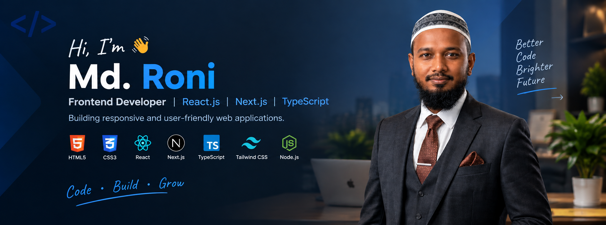

 

<!-- Banner -->

# 👋 Hi, I'm Md. Roni

### Frontend Developer | React.js | Next.js | TypeScript

Building modern, responsive, and user-friendly web applications.

  
  
  

---

## 👨‍💻 About Me

I'm a passionate **Frontend Developer** focused on building modern, responsive, and user-friendly web applications.

I enjoy transforming ideas and designs into functional web experiences using modern frontend technologies. I love learning new technologies, solving problems, and improving my development skills through real-world projects.

- 🔭 Currently building web applications with **React.js and Next.js**
- 🌱 Exploring **Advanced React, Next.js, TypeScript, and Full-Stack Development**
- 💻 Experienced in developing responsive and reusable UI components
- 🔌 Working with REST APIs and dynamic data integration
- 🎨 Passionate about clean UI/UX and modern web design
- 🚀 Continuously improving my problem-solving and development skills
- 📫 Reach me at: [mohammadroni0187@gmail.com](mailto:mohammadroni0187@gmail.com)

---

## 🛠️ Skills & Technologies

### 💻 Programming Languages

  

### ⚛️ Frontend Development

  

### 🔧 Backend & Database

  

### 🧰 Tools & Platforms

  

---

## ⭐ Popular Repositories

Here are some of my featured projects and repositories.

<table>
<tr>
<td width="50%">
<h3>🛒 BazerDor</h3>

A modern e-commerce web application focused on providing a user-friendly shopping experience.

<a href="https://github.com/mohammadroni0187-arch/bazer-dor-web-site">View Repository →</a>
</td>
<td width="50%">
<h3>📚 Online Library</h3>

A web application for exploring and managing an online collection of books.

<a href="https://github.com/mohammadroni0187-arch/online-library">View Repository →</a>
</td>
</tr>
<tr>
<td width="50%">
<h3>🌐 My Portfolio</h3>

A personal developer portfolio showcasing my skills, projects, and development journey.

<a href="https://github.com/mohammadroni0187-arch/my-portfolio">View Repository →</a>
</td>
<td width="50%">
<h3>🏋️ FitLog</h3>

A workout management application featuring workout browsing, dynamic details, and workout planning.

<a href="https://github.com/mohammadroni0187-arch/fit-log-app">View Repository →</a>
</td>
</tr>
</table>

---

## 🚀 Featured Projects

### 🌐 My Portfolio
A modern personal portfolio website showcasing my skills, projects, and experience.

**Tech Stack:** Next.js • React.js • TypeScript • Tailwind CSS

🔗 [Live Demo](https://my-portfolio-evwhpv3zm-md-roni2.vercel.app/) | [GitHub Repository](https://github.com/mohammadroni0187-arch/my-portfolio)

---

### 🏋️ FitLog – Workout Management Application

A workout management application designed to help users explore workouts and organize their fitness activities.

**Tech Stack:** Next.js • React.js • TypeScript • Tailwind CSS

🔗 [Live Demo](https://fit-log-c53vajaob-md-roni2.vercel.app/) | [GitHub Repository](https://github.com/mohammadroni0187-arch/fit-log-app)

---

### 🛒 BazerDor – E-commerce Web Application

A modern e-commerce web application focused on providing a user-friendly online shopping experience.

**Tech Stack:** Next.js • React.js • TypeScript • MongoDB

🔗 [Live Demo](https://bazer-dor-web-site-enhpa3inf-md-roni2.vercel.app/) | [GitHub Repository](https://github.com/mohammadroni0187-arch/bazer-dor-web-site)

---

### 📚 Online Library

A web application for browsing and exploring books through an online library interface.

**Tech Stack:** Next.js • React.js • TypeScript

🔗 [GitHub Repository](https://github.com/mohammadroni0187-arch/online-library)

---

## 📊 GitHub Statistics

 

---

## 📈 Contribution Activity

---

## 🐍 Contribution Snake

---

## 🏆 GitHub Trophies

---

## 🤝 Connect With Me

I'm always interested in connecting with developers, collaborating on projects, and exploring new opportunities.

📍 **Location:** Bangladesh

---

### 🚀 Always Learning. Always Building. Always Growing.

**Thanks for visiting my GitHub profile!**

⭐ Feel free to explore my repositories and connect with me.

