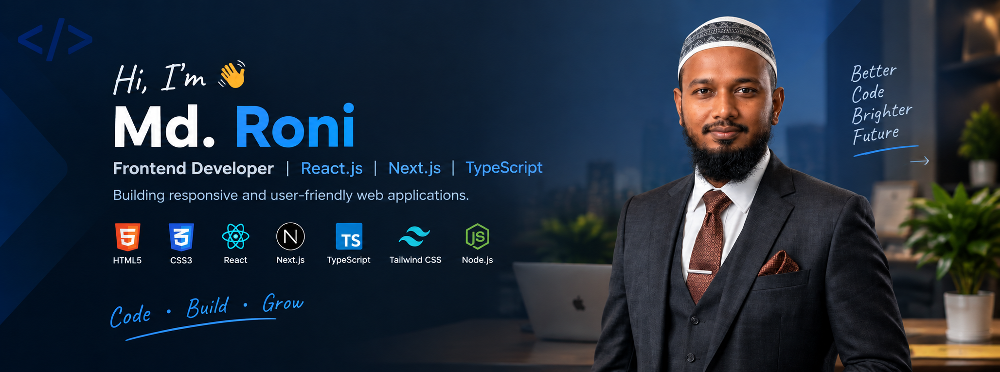

<!-- Banner -->

 

# Hi, I'm Md. Roni 👋

### Full-Stack Web Developer · React · Next.js · TypeScript · Node.js

 

  
  
  

---

## 👨‍💻 About Me

I'm a **Full-Stack Web Developer** who builds modern, responsive and user-friendly web applications — from polished interfaces to the APIs and databases behind them.

I like turning ideas into real products, learning by shipping projects, and writing clean, reusable code.

|  |  |
| :-- | :-- |
| 🔭 **Currently building** | Full-stack apps with Next.js, Node.js, Express & MongoDB |
| 🌱 **Learning** | Advanced React, Next.js, TypeScript and system design |
| 🔐 **Working with** | Authentication (Better Auth, JWT), payments (Stripe) and REST APIs |
| 🎨 **Passionate about** | Clean UI/UX and accessible, responsive design |
| 📍 **Location** | Bangladesh |
| 📫 **Reach me** | [mohammadroni0187@gmail.com](mailto:mohammadroni0187@gmail.com) |

---

## 🛠️ Tech Stack

| | Technologies |
| :-- | :-- |
| **Languages** |  |
| **Frontend** |  |
| **Backend & Database** |  |
| **Tools & Platforms** |  |

---

## 🚀 Featured Project

### 🎓 MentorLagbe — Online Tuition & Tutor Finding Platform

MentorLagbe is a **full-stack tuition management platform** that connects students with tutors, simplifies tuition discovery and manages tuition applications — with **role-based dashboards** for students, tutors and administrators.

  

**Highlights**

- 👥 Role-based dashboards for **students, tutors and admins**
- 🔎 Tutor discovery and tuition application management
- 🔐 Secure authentication with **Better Auth + JWT**
- 💳 Online payments with **Stripe**

  

---

## ⭐ More Projects

<table>
<tr>
<td width="50%" valign="top">

### 📚 Book-Nook
Online library management app for organizing books and managing borrowing activity, with a separate backend API.

[🔗 Live Demo](https://online-library-qtj5.vercel.app) · [💻 Code](https://github.com/mohammadroni0187-arch/online-library)

</td>
<td width="50%" valign="top">

### 🛒 BazerDor
Modern e-commerce web application focused on a clean, user-friendly shopping experience.

[🔗 Live Demo](https://bazer-dor-web-site.vercel.app) · [💻 Code](https://github.com/mohammadroni0187-arch/bazer-dor-web-site)

</td>
</tr>
<tr>
<td width="50%" valign="top">

### 🏋️ FitLog
Workout library with API integration, dynamic routing and a personal plan of up to five saved workouts.

[🔗 Live Demo](https://fit-log-app-teal.vercel.app) · [💻 Code](https://github.com/mohammadroni0187-arch/fit-log-app)

</td>
<td width="50%" valign="top">

### 🌐 My Portfolio
Personal developer portfolio showcasing my skills, projects and journey.

[🔗 Live Demo](https://my-portfolio-eta-gilt-aocqw48xfs.vercel.app) · [💻 Code](https://github.com/mohammadroni0187-arch/my-portfolio)

</td>
</tr>
<tr>
<td width="50%" valign="top">

### 🧩 Dev Stack
Technology stack explorer where users add or remove items from their personal stack.

[🔗 Live Demo](https://dev-stack-roni.netlify.app/) · [💻 Code](https://github.com/mohammadroni0187-arch/Fast-Project)

</td>
<td width="50%" valign="top">

### 🎤 DevConf
Responsive conference website with a speaker section and event-focused layout.

[🔗 Live Demo](https://mohammadroni0187-arch.github.io/Assignment/) · [💻 Code](https://github.com/mohammadroni0187-arch/Assignment)

</td>
</tr>
</table>

---

## 📊 GitHub Stats

---

## 📈 Contribution Activity

---

## 🏆 GitHub Trophies

---

## 🤝 Let's Connect

I'm open to **freelance projects, collaborations and full-time opportunities**. If you have an idea, let's build it together.

  

### 🚀 Always Learning. Always Building. Always Growing.

